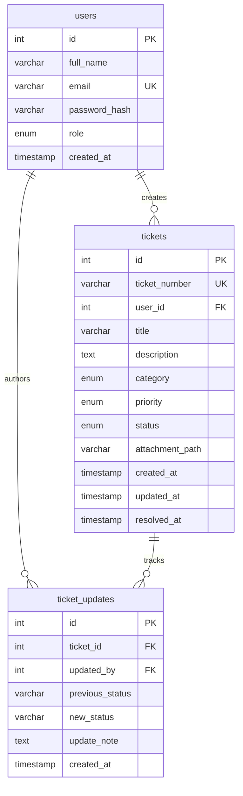

# IT DeskPro — Enterprise IT Service Desk & Ticket Analytics

**IT DeskPro** is a modern, full-stack IT Service Desk and Ticket Analytics web application built with **Python**, **Streamlit**, and a **MySQL** relational database. It streamlines internal incident reporting, service requests, SLA resolution tracking, and organizational analytics with role-based access control (RBAC).

---

## 🌟 Key Features

### 1. Multi-Role Authentication & Access Control (RBAC)
- **Three Core Roles:**
  - `Employee`: Submits support tickets, tracks personal tickets, views technician resolution notes.
  - `IT Support`: Manages all organizational tickets, changes priorities, updates ticket status, logs resolution notes.
  - `Admin`: Full operational oversight, SLA analytics, ticket management, and company-wide reporting.
- **Secure Password Hashing:** Powered by `bcrypt` (12 salt rounds). Zero plain-text passwords stored.
- **Session Protection:** Role-gated server-side routing ensures employees cannot view administrative views or analytics.

### 2. Employee Support Portal
- **Interactive KPI Cards:** Total submitted tickets, open tickets, in-progress requests, and resolved/closed requests.
- **Live Ticket Submission Form:**
  - Real-time client & server validation (title min 5 chars, description min 10 chars).
  - Categorization: *Hardware, Software, Network, Email, Access/Login, Other*.
  - Priority levels: *Low, Medium, High, Critical*.
  - Safe file attachments: Enforces max 5MB size limit and safe extensions (`.png`, `.jpg`, `.jpeg`, `.pdf`, `.docx`, `.xlsx`, `.txt`, `.log`).
  - Unique auto-incrementing sequential ticket numbers (e.g., `ITD-2026-0001`).
- **My Tickets Console:**
  - Full-text search by ticket number or issue keywords.
  - Multi-criteria filters: Status, Category, Priority.
  - Chronological sort: Newest or Oldest first.
  - Real-time resolution timeline: Complete audit trail showing who updated the ticket, when, and their technical notes.

### 3. IT Support & Admin Operations Hub
- **Executive Operations Dashboard:**
  - Real-time KPI indicators: *Total Tickets, Open Queue, In Progress, Resolved Tickets, Critical Active Tickets, Average Resolution Time*.
  - **⚡ Immediate Attention Queue:** Surfaces high-risk and critical tickets requiring immediate technician intervention.
  - Dynamic Plotly status, priority, and category distribution charts.
  - Recent company-wide incident table.
- **Ticket Management & Resolution Console:**
  - Master search across ticket numbers, titles, and employee names/emails.
  - Split-view interface: Ticket queue selector on the left, resolution console on the right.
  - In-place status transitions (`Open` &rarr; `In Progress` &rarr; `Resolved` &rarr; `Closed`).
  - Automatic `resolved_at` timestamp recording when tickets are marked `Resolved`.
  - Immutable audit logging: Every status or priority change appends an entry to `ticket_updates`.

### 4. Enterprise Analytics & SLA Reporting
- **Pandas & Plotly Visualizations:**
  - **Tickets by Category** (Interactive Bar Chart)
  - **Tickets by Status** (Interactive Donut Chart)
  - **Tickets by Priority** (SaaS-styled Bar Chart)
  - **Monthly Ticket Creation Trend** (Spline Line Chart)
- **Key Operational Metrics:** Total volume, Resolution Rate (%), Average Resolution Time, and Critical count.
- **Configurable Date Range:** Filter records by preset (Past 30 Days, Past 90 Days, Past 6 Months, Year-to-Date, All Time) or custom Start/End dates.
- **One-Click CSV Export:** Download filtered datasets for external audit reporting.

### 5. Profile & Security
- View employee metadata (Name, Email, Account Creation Date, Role).
- Update display name.
- Change password securely with current password verification.

---

## 🛠️ Technology Stack

| Layer | Technology | Purpose |
|---|---|---|
| **Programming Language** | Python 3.11+ | Application core logic & business rules |
| **Frontend UI** | Streamlit 1.36+ | Responsive SaaS web interface |
| **Relational Database** | MySQL 8.0+ | Persistent transactional data storage |
| **Database Driver** | `mysql-connector-python` | Parameterized SQL execution & connection management |
| **Data Analysis** | Pandas 2.2+ | Data manipulation, aggregations, and metrics |
| **Data Visualization** | Plotly 5.24+ | Interactive corporate charts |
| **Security & Hashing** | Bcrypt 4.1+ | Salted password hashing |
| **Configuration** | `python-dotenv` | Environment variable management |

---

## 📁 Project Structure

```text
IT-DeskPro/
│
├── app.py                      # Main application entry point & role router
├── config.py                   # Central settings, categories, priorities, palettes
├── database.py                 # MySQL connection pooling & parameterized query execution
├── requirements.txt            # Python dependencies
├── README.md                   # System documentation & deployment guide
├── .env.example                # Sample environment template
├── .env                        # Local database configuration (git-ignored)
├── .gitignore                  # Git exclusions for secrets, uploads, and pycache
│
├── pages/                      # Modular application views
│   ├── login.py                # Authentication, employee registration & demo shortcuts
│   ├── employee_dashboard.py   # Personal metrics, status breakdown, ticket creation CTA
│   ├── create_ticket.py        # Validated ticket submission & attachment upload
│   ├── my_tickets.py           # Personal ticket tracker with audit trail expanders
│   ├── admin_dashboard.py      # Operations KPI cards, attention queue & volume charts
│   ├── manage_tickets.py       # IT technician resolution console & audit logger
│   ├── analytics.py            # Pandas/Plotly analytics & CSV report export
│   └── profile.py              # Profile name updates & password change form
│
├── utils/                      # Core business logic helpers
│   ├── authentication.py       # Bcrypt password hashing, session state & role guards
│   ├── ticket_functions.py     # Ticket CRUD, numbering, status updates & audit trail
│   ├── validation.py           # Regex email validation, field limits & file upload checks
│   ├── analytics.py            # DataFrame aggregations & Plotly chart builders
│   └── ui_components.py        # SaaS badges, KPI card renderer & custom CSS loader
│
├── database/                   # Database scripts
│   ├── schema.sql              # MySQL schema (users, tickets, ticket_updates)
│   └── seed_demo_data.py       # Safe demo data generator (15 users, 40+ tickets)
│
├── assets/                     # UI styling
│   └── style.css               # Navy sidebar, SaaS KPI cards, status badges
│
├── tests/                      # Automated test suite
│   └── test_all_features.py    # 17-point automated verification suite
│
└── uploads/                    # Secure local directory for ticket attachments
```

---

## 🗄️ Database Architecture (`database/schema.sql`)

The database consists of three relational tables enforcing referential integrity:



---

## 🚀 Installation & Setup Guide (Windows PowerShell)

### Step 1: Clone or Navigate to the Workspace
Open Windows PowerShell:
```powershell
cd "c:\Users\Admin\Desktop\IT - Desk Pro"
```

### Step 2: Install Python Dependencies
Ensure Python 3.11+ is installed. Install all required packages:
```powershell
pip install -r requirements.txt
```

### Step 3: Configure Environment Variables
Copy `.env.example` to `.env` and verify database credentials:
```powershell
Copy-Item .env.example .env
```
Inside `.env`:
```ini
DB_HOST=127.0.0.1
DB_PORT=3306
DB_USER=root
DB_PASSWORD=
DB_NAME=it_deskpro

APP_NAME=IT DeskPro
MAX_UPLOAD_SIZE_MB=5
ALLOWED_EXTENSIONS=png,jpg,jpeg,pdf,txt,docx,xlsx,log
```

### Step 4: Ensure MySQL is Running
If running MySQL Server:
```powershell
# Verify MySQL connection
& "C:\Users\Admin\mysql-server\PFiles64\MySQL\MySQL Server 8.0\bin\mysql.exe" -u root -e "SHOW DATABASES;"
```
*(If MySQL is not currently running as a service, start mysqld via:)*
```powershell
& "C:\Users\Admin\mysql-server\PFiles64\MySQL\MySQL Server 8.0\bin\mysqld.exe" --datadir="C:\Users\Admin\mysql-data" --port=3306 --console
```

### Step 5: Initialize Schema & Seed Demo Data
Run the safe seeder script to populate realistic accounts, multi-month tickets, and resolution history:
```powershell
python database/seed_demo_data.py
```
*(If you ever want to re-seed demo data from scratch, pass the `--force` flag: `python database/seed_demo_data.py --force`)*

### Step 6: Launch the Web Application
Start Streamlit:
```powershell
streamlit run app.py
```
Open your browser and navigate to:
👉 **`http://localhost:8501`**

---

## 🔑 Demo Login Credentials

For quick evaluation, all seeded demo accounts share the password: **`Password123!`**

| Role | Name | Email | Password | What You Can Access |
|---|---|---|---|---|
| **Admin** | Alex Rivera | `alex.rivera@deskpro.local` | `Password123!` | Executive dashboard, Manage all tickets, Analytics, CSV export |
| **IT Support** | Sarah Chen | `sarah.chen@deskpro.local` | `Password123!` | Operations dashboard, Ticket resolution, Status updates, Notes |
| **IT Support** | Marcus Vance | `marcus.vance@deskpro.local` | `Password123!` | Operations dashboard, Ticket resolution, Status updates, Notes |
| **Employee** | Emily Watson | `emily.watson@deskpro.local` | `Password123!` | Employee dashboard, Submit tickets, Personal ticket history |
| **Employee** | David Kim | `david.kim@deskpro.local` | `Password123!` | Employee dashboard, Submit tickets, Personal ticket history |
| **Employee** | Jessica Taylor | `jessica.taylor@deskpro.local` | `Password123!` | Employee dashboard, Submit tickets, Personal ticket history |

*Note: You can also register your own employee account directly from the **Register Employee** tab on the login screen.*

---

## 🧪 Verification & Automated Testing

A dedicated test suite `tests/test_all_features.py` covers all 17 requirements:

To run the complete verification suite:
```powershell
python tests/test_all_features.py
```

### Test Results Summary:
```text
======================================================================
 RUNNING IT DESKPRO VERIFICATION TEST SUITE (17 CHECKLIST ITEMS)
======================================================================
  [PASS] Test 17: Database connection handled gracefully
  [PASS] Test 01: Valid login authentication
  [PASS] Test 02: Invalid login rejection
  [PASS] Test 03: Logout clears session state
  [PASS] Test 04: Employee blocked from admin operations
  [PASS] Test 06: Empty ticket fields rejected
  [PASS] Test 07: Unique ticket number format ITD-YYYY-XXXX
  [PASS] Test 05: Employee can create a ticket
  [PASS] Test 08: Employee sees only their own tickets
  [PASS] Test 09: Admin can view all tickets across employees
  [PASS] Test 10: Admin can update ticket status and priority
  [PASS] Test 11: Ticket history audit log preserved
  [PASS] Test 12: Resolution timestamp is recorded on Resolved
  [PASS] Test 13: Search and multi-criteria filters work
  [PASS] Test 14: Analytics calculate real database figures
  [PASS] Test 15: CSV export generates valid data stream
  [PASS] Test 16: Invalid file attachments are rejected
======================================================================
 TEST RESULTS SUMMARY: 17 PASSED / 0 FAILED (TOTAL 17)
======================================================================
```

---

## 🛡️ Security & Best Practices

1. **SQL Injection Prevention:** Every database query in `database.py`, `utils/ticket_functions.py`, and `utils/authentication.py` uses parameterized queries (`%s`), never raw string formatting.
2. **Password Security:** Hashes stored using `bcrypt` with automatic salt generation. Passwords are never saved in plain text.
3. **Role Enforcement:** Server-side route validation (`check_role_access`) ensures users cannot bypass access by altering client URLs.
4. **File Upload Security:** Uploaded files are checked against allowed extensions, file size limits (5MB), and stored with randomized secure filenames (`uuid_clean_name.ext`) to avoid directory traversal.
5. **Session Safety:** Sensitive fields (`password_hash`) are stripped before saving user state into `st.session_state`.

---

## 💡 Troubleshooting & Common Issues

| Issue | Cause | Solution |
|---|---|---|
| `Database connection failed: Can't connect to MySQL server on '127.0.0.1'` | MySQL server is stopped or port 3306 is blocked. | Verify MySQL service is started. On Windows, verify using `Test-NetConnection -ComputerName localhost -Port 3306`. |
| `Unsupported file type (.exe)` | Attempted to upload an executable or disallowed attachment. | Only standard document and image formats are permitted (`.png`, `.jpg`, `.pdf`, `.docx`, etc.). |
| `Access Denied: You do not have permission` | An Employee account tried accessing an Admin/IT Support page. | Sign out and log in with an IT Support (`sarah.chen@deskpro.local`) or Admin (`alex.rivera@deskpro.local`) account. |
| `Invalid email or password` | Incorrect login credentials. | Use default demo credentials (`Password123!`) or create a new account via the **Register Employee** tab. |

---

## 🔮 Future Roadmap
- Email notifications upon ticket status transitions using SMTP/SendGrid.
- SLA breach timers and automated escalation alerts for Critical tickets.
- IT Engineer workload assignment and capacity balancing.
- Live chat / commentary thread between employees and IT technicians.

